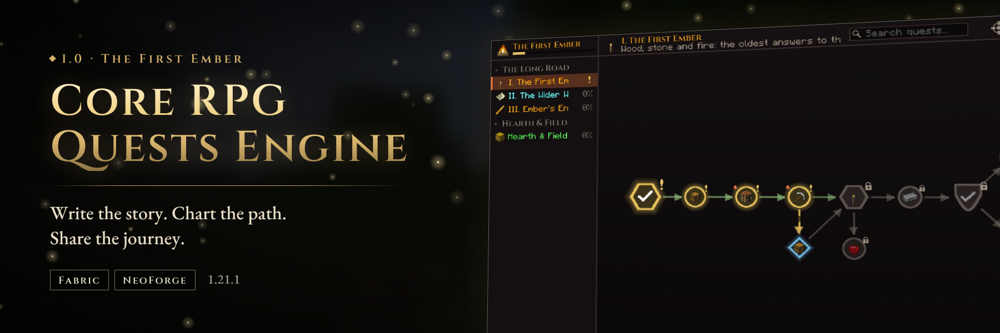

**[Book format](https://github.com/MeherBenSalem/NoMore63AE2/blob/main/docs/BOOK_FORMAT.md) · [Discord](https://discord.gg/TJc3CxR4jK) · [Source and issues](https://github.com/MeherBenSalem/NoMore63AE2)**

## A quest book for RPG modpacks

Write a story in chapters, branch it, lock paths behind choices, and let your players walk it together. **Core RPG - Quests Engine** is one mod with everything a quest-driven pack needs: the quest book and its **in-game editor**, **teams and parties** with shared progress, **team stages**, **smart item filters** and **vein mining**. It covers what the FTB Quests suite does, in original code, with an RPG look of its own.

**1.0 "The First Ember"** is available for **NeoForge and Fabric** on **1.21.1**. A small example book, *The First Ember*, is written to your config the first time a server starts, so you can see every feature at work.

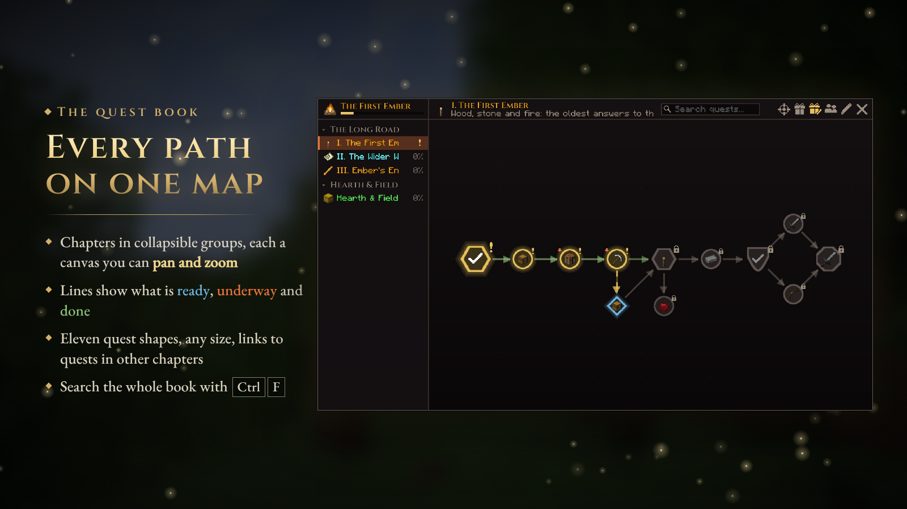

Press **J** (or use the Quest Book item). Chapters sit on the left in collapsible groups; each chapter is a canvas of quests you can **pan and zoom**.

- **Read it at a glance.** Lines between quests show what is locked, ready (animated), underway, waiting to be claimed and done.
- **Shape it.** Circles, squares, diamonds, hexagons, hearts, gears, shields, stars and more, at any size. Link a quest into another chapter, and decorate chapters with clickable images.
- **Find it.** Search the whole book with **Ctrl + F**. Pin quests to the tracker on your screen.

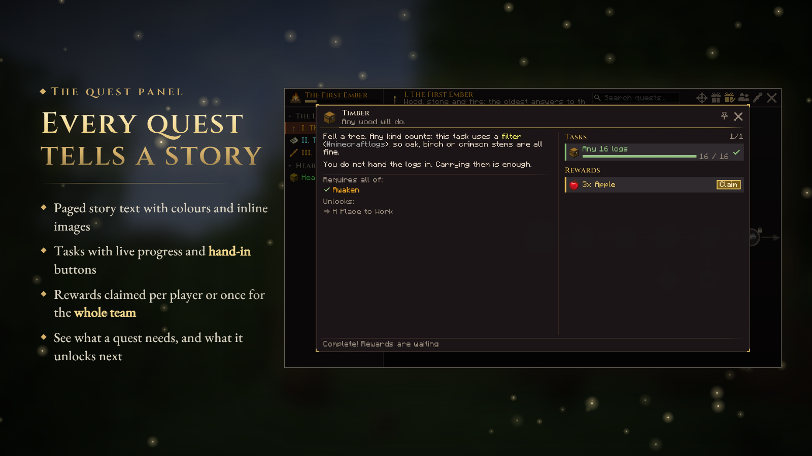

Open a quest to read its story, with **colours, page breaks and inline images**, and see its tasks with live progress, **hand-in** buttons and its rewards. The panel also shows what the quest needs and what it unlocks next.

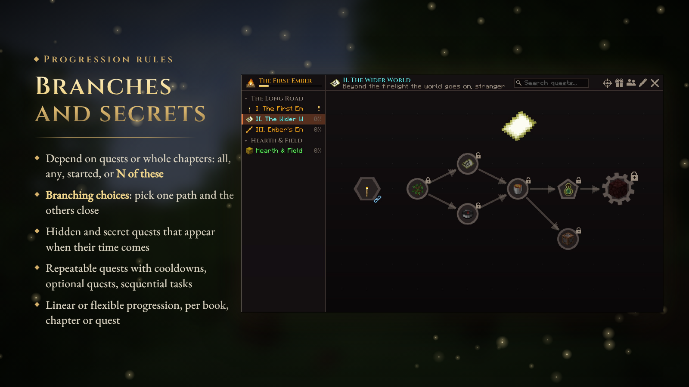

- **Dependencies** on quests or whole chapters: all of them, any of them, all started, any started, or **N of these**.
- **Branching choices.** Let a quest allow only one of its follow-ups: pick a path and the others close.
- **Secrets.** Invisible quests, quests that appear after N tasks, quests hidden until their dependencies are done or visible, hidden text, hidden details.
- **Pacing.** Linear or flexible progression, sequential tasks, optional tasks and quests, repeatable quests with cooldowns, completion commands.
- **Control.** Lock a team's progress or block its rewards with one command.

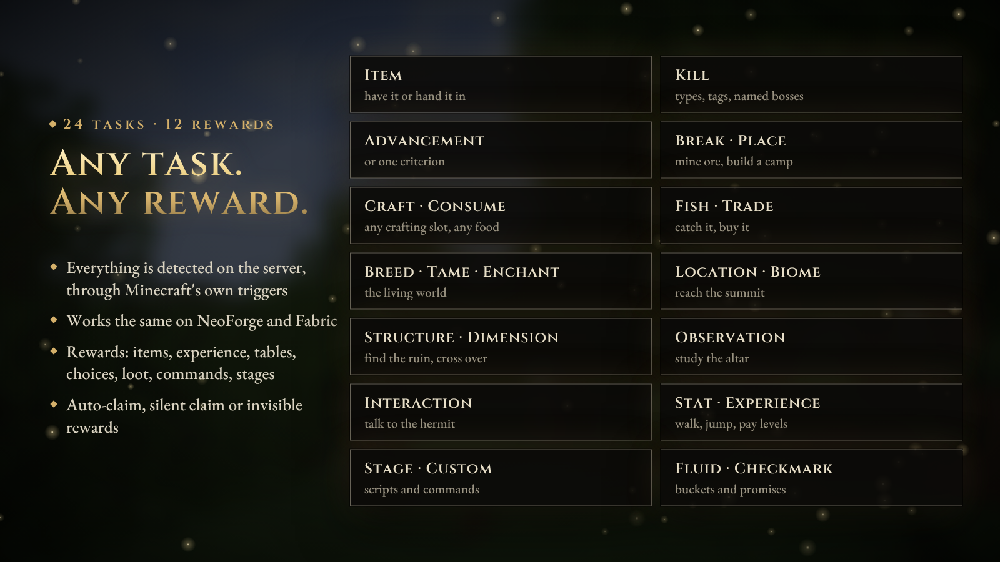

**24 task types**: item (have it or hand it in, with smart filters and component matching), checkmark, kill (type, tag or a named boss), advancement (or one criterion), location, dimension, biome, structure, stat, experience, observation, interaction, stage, custom, fluid, break block, place block, craft, consume, fish, trade, breed, tame and enchant. Everything is detected **on the server** through Minecraft's own triggers, so it behaves the same on NeoForge and Fabric.

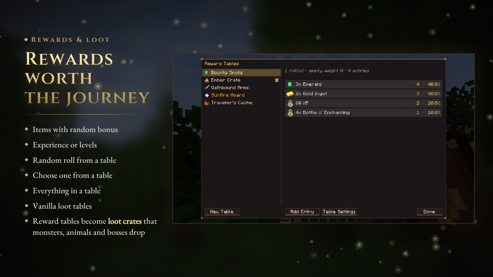

**12 reward types**: items (with a random bonus), experience points or levels, a random roll from a reward table, a **choice** of one entry, everything in a table, vanilla loot tables, commands, advancements, story toasts, team stages and custom rewards for scripts.

- Rewards are claimed by each player, or **once for the whole team**.
- Auto-claim them, silently or invisibly, or leave them out of "claim all".
- Turn a reward table into a **loot crate** that monsters, animals and bosses can drop.

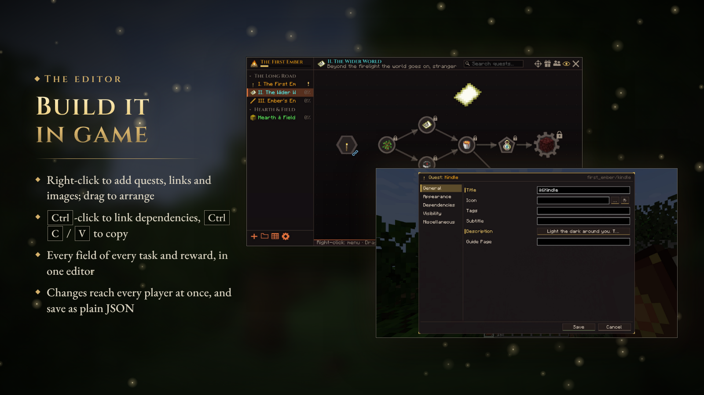

Operators click the pencil and the book becomes its own editor:

- **Right-click** the canvas to add quests, quest links and images; right-click a quest to add tasks and rewards.
- **Drag** to move (snapped to the grid), **Shift**-click or Shift-drag to select, **Ctrl**-click to link dependencies, **Ctrl + C / V** to copy and paste.
- **Every field** of every task and reward is editable, in an editor generated from each object's definition, with a text editor that previews colours and pages.
- Reward tables, chapter groups, chapter order and book settings, all in game. **Complete** or **reset** anything for your team to test it.
- Every change reaches every player at once.

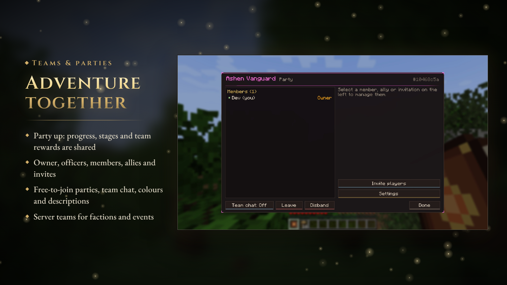

- Everyone has a personal team. **Parties** share quest progress, stages and team rewards.
- Owner, officers, members, **allies** and **invites**; free-to-join parties, team chat, a colour and a description; a size limit set by the server.
- **Server teams** for factions and events, and **team stages** that quests, commands and other mods can read and set.
- Manage it all from the team screen or the `/team` command.

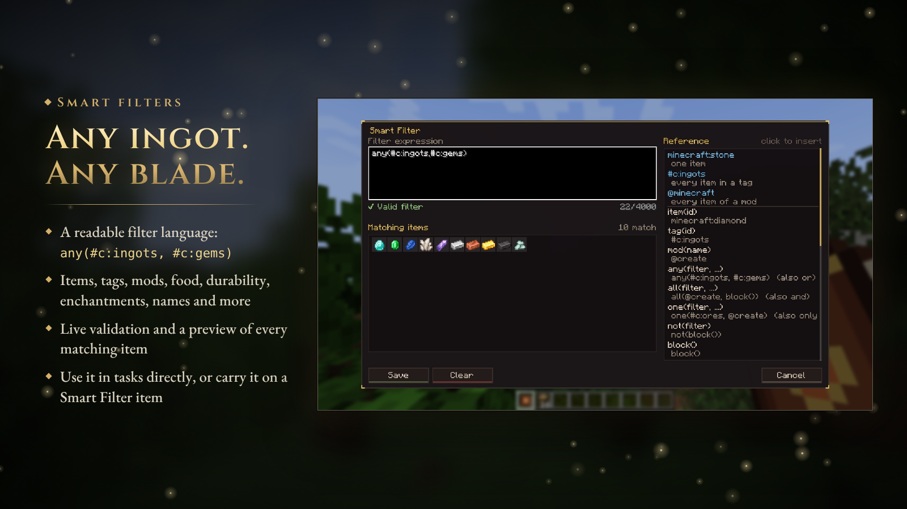

One item task can accept a whole family of items with a readable filter, such as `any(#c:ingots, #c:gems)` or `all(@create, not(block()))`. Filters cover items, tags, mods, food, durability, stack size, names, components, enchantments and rarity. Type one into a task, or carry it on a **Smart Filter** item, whose editor checks the filter as you type and previews every item it matches.

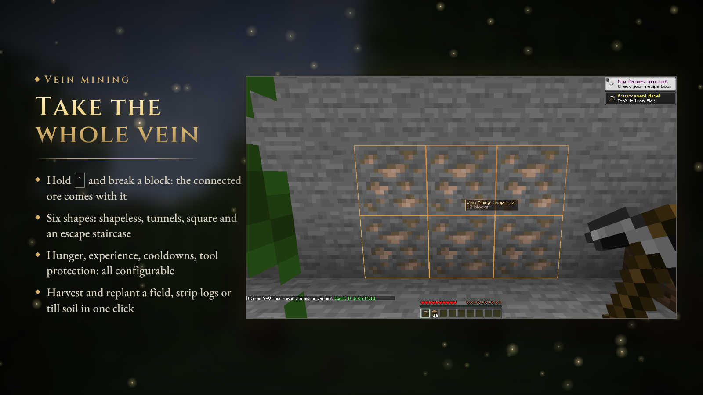

Hold **`** and break a block: the connected vein comes with it, outlined before you swing. Scroll while holding the key to switch shape: **shapeless, 1x1 tunnel, 1x2 tunnel, 3x3 tunnel, 3x3 square** or an **escape staircase**.

- Hunger and experience costs, a cooldown, a block limit, tool-break protection and correct-tool rules, all in `server.toml`.
- Deepslate and stone variants of an ore count as one vein (`c:ores/*` merge tags). Drops gather at the first block.
- With the key held, **right-click** to harvest and replant a field, strip a tree, make a path or till the soil.

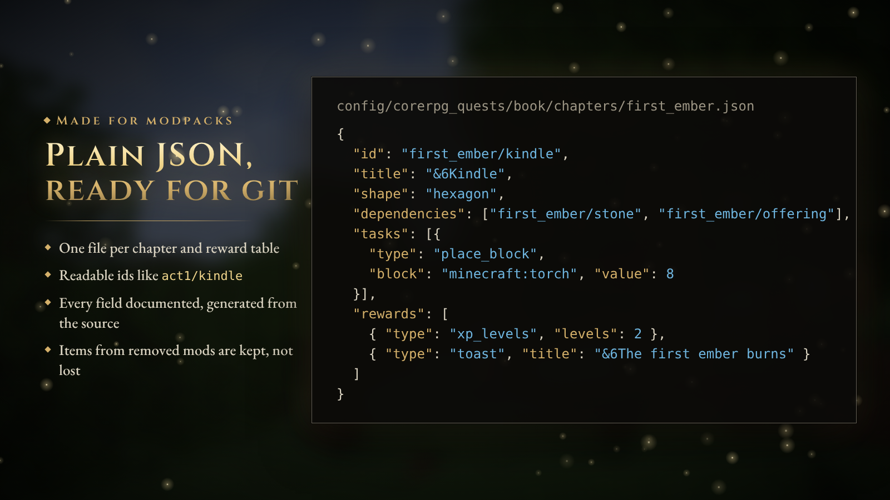

- The book lives in `config/corerpg_quests/book/`: one readable JSON file per chapter and reward table, easy to diff, review and generate with tools.
- Readable ids such as `act1/kindle`. Text supports colour codes and translation keys.
- Every field is documented in the **[book format reference](https://github.com/MeherBenSalem/NoMore63AE2/blob/main/docs/BOOK_FORMAT.md)**, generated from the source.
- Items, tasks and rewards from mods you remove are kept as placeholders, not deleted.

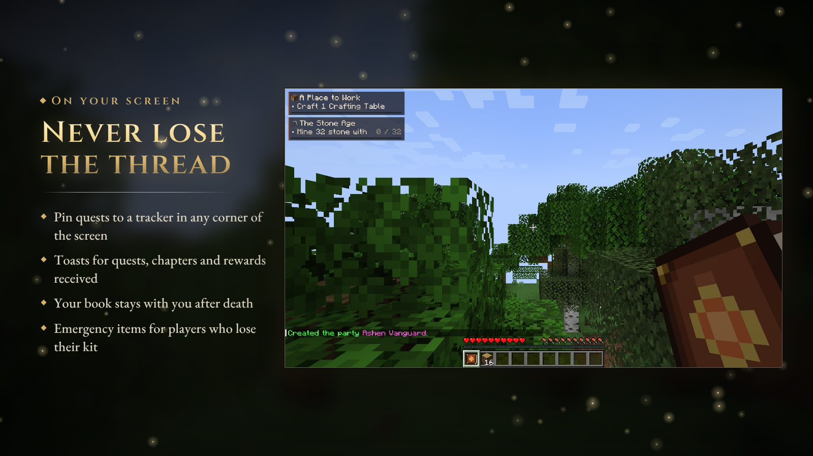

- **Pinned-quest tracker** in any corner, and toasts for quests, chapters, the whole book and rewards received.
- **The quest book stays with you** after death, and the book can hand out **emergency items** on a cooldown.
- **Commands** for operators: complete or reset quests, chapters or the whole book for a team, give and remove stages, progress custom tasks from command blocks and datapacks, reload and export the book.
- **Events and an API** for addons and scripts: quest started and completed, task and chapter completed, reward claimed, custom rewards, stage and team changes. Register your own task, reward and filter types.
- **Settings** for the server (parties, editor permission, every vein-mining rule) and for each player (tracker corner and size, toasts, sounds, the outline preview, fonts).

| Minecraft | Loaders | Also install |
| --- | --- | --- |
| 1.21.1 | NeoForge, Fabric | Fabric API (Fabric) |

- Download the file whose name matches your loader: `-neoforge-` or `-fabric-`.
- Install it on **both the server and every client**, at the same version.
- Use it **instead of** FTB Quests and FTB Ultimine, not alongside them.
- It is a mod. It does not work as a Paper, Spigot or Folia plugin.

**Can I bring my FTB Quests book over?**
Not automatically yet. The book format is different (plain JSON instead of SNBT); it is fully documented and easy to generate with a script. Quest blocks (task screens, barriers, detectors), energy tasks and the KubeJS and JEI integrations are not part of 1.0.

**Do players need the mod?**
Yes. The quest book, the editor and the vein-mining preview run on the client.

**Is progress per player or per team?**
Per team. Every player starts with a personal team; joining a party shares that party's progress.

**Can other mods or scripts drive quests?**
Yes. Custom tasks and rewards, team stages and commands work with command blocks, datapacks and scripts, and the Java API exposes events and lets you register new task, reward and filter types.

**Is it heavy?**
Most tasks react to events instead of polling. Location-style tasks are checked every second by default (`detection_delay`), spread across players, and only for quests a team can progress.

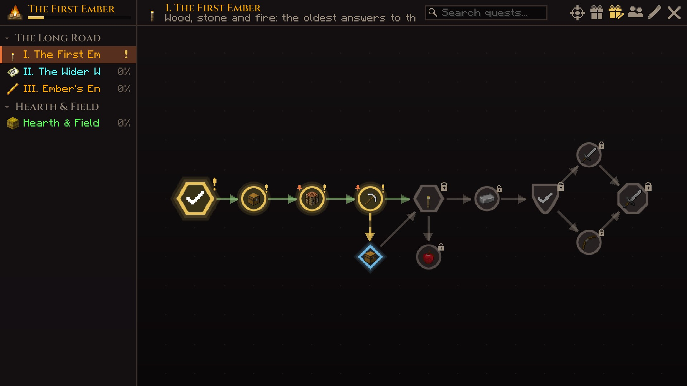

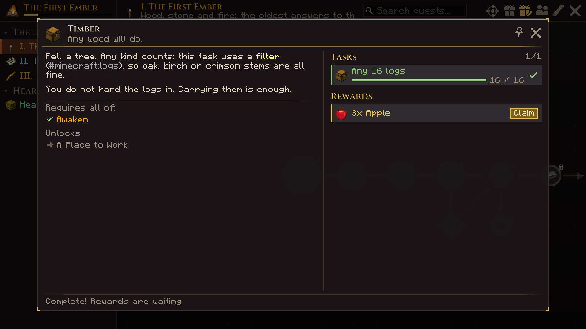

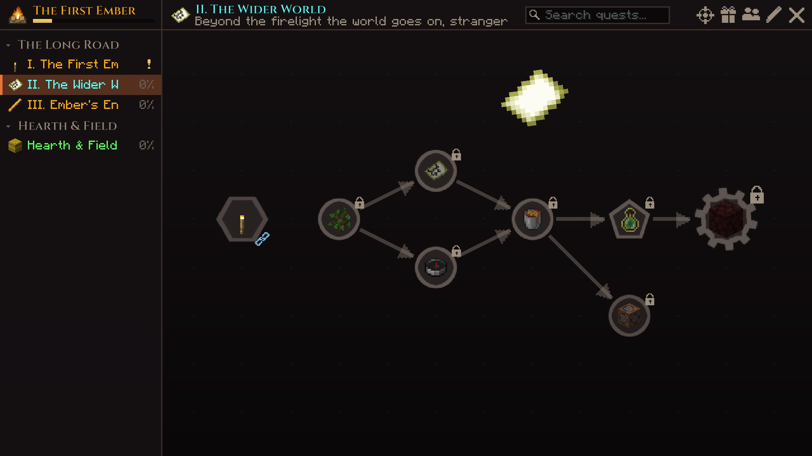

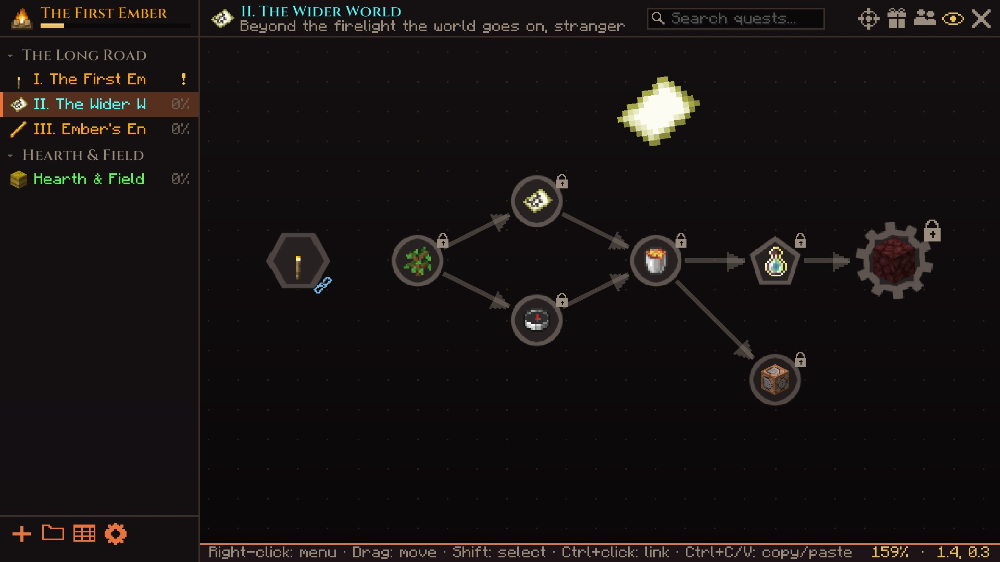

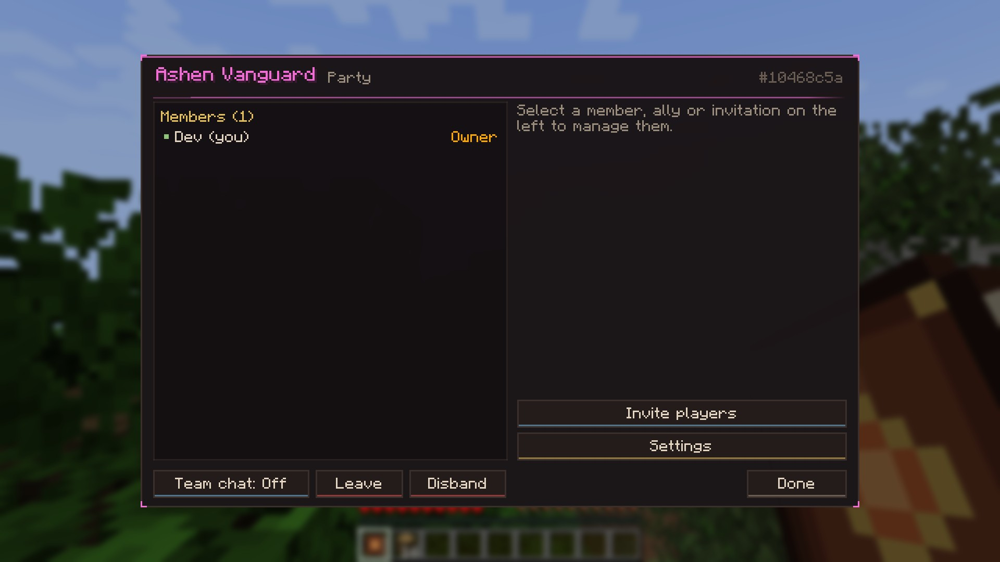

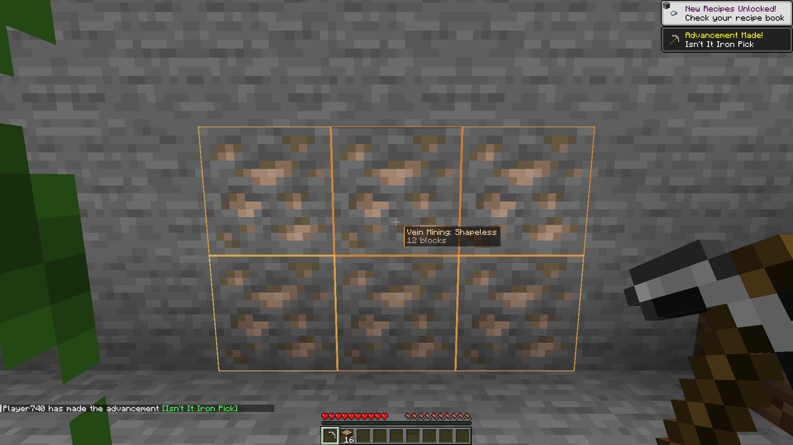

---

Core RPG - Quests Engine is licensed under Apache-2.0. The bundled Cinzel and EB Garamond fonts are licensed under the SIL Open Font License 1.1. Core RPG - Quests Engine is an independent project and is not affiliated with Feed The Beast or any mod it takes inspiration from.

---

> **Play it in [Remnants: Ashen Legacy](https://www.curseforge.com/minecraft/modpacks/remnants-ashen-legacy)**, NightBeam's story-driven soulslike RPG modpack.

---

### More from NightBeam Studio

- **[Remnants: Ashen Legacy](https://www.curseforge.com/minecraft/modpacks/remnants-ashen-legacy)**: the story-driven soulslike RPG modpack built on NightBeam's mods
- **[Premium server plugins](https://nightbeam.dev/store)**: anti-cheat, ranked PvP, SMP setups and more on BuiltByBit
- **[NightBeam Pro](https://nightbeam.dev/memberships)**: the model library and NightBeam Forge credits, from $5 a month
- **[Discord](https://discord.gg/TJc3CxR4jK)**: support, bug reports, suggestions and early looks
- **[Support NightBeam](https://nightbeam.dev/support)**: help keep every mod free

**Follow:** [YouTube](https://www.youtube.com/@nightbeamstudio) · [Instagram](https://www.instagram.com/nightbeamstudio/) · [X](https://x.com/NightBeamLLC) · [Facebook](https://www.facebook.com/profile.php?id=61574823331471)
